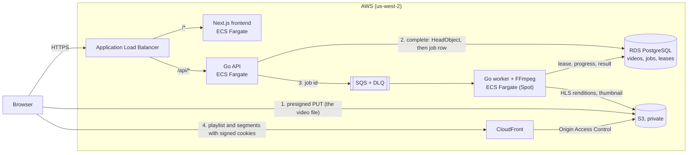

# RyuZCloud

A video platform where browsers upload straight to object storage and a separate Go worker turns each upload into
adaptive-bitrate HLS with FFmpeg, built to show how to keep large files out of the API and job state correct through
crashes and retries.

<!-- Screenshot: added after the frontend redesign (docs/metrics.md, phase 3). -->

## What it demonstrates

- **Direct-to-storage uploads.** The API signs a presigned `PUT` URL and the browser sends the file to S3 (MinIO
  locally). Video bytes never pass through the API. On completion the API confirms the object with `HeadObject`, then
  marks the video `queued` and creates its job in one transaction.
- **A crash-safe worker.** Jobs live in PostgreSQL, and a worker claims a job with a 120 s lease and a heartbeat. The
  queue (Redis locally, SQS with a dead-letter queue on AWS) is acknowledged only after the database commit. If a worker
  is killed mid-encode, its lease expires and another attempt finishes the job. Measured: 43 of 43 end-to-end checks
  ([R2](docs/metrics.md)).
- **HLS transcoding.** `ffprobe`, then 360p and 720p renditions (never upscaled), a thumbnail, and the master playlist
  written last, so a half-finished video is never playable.
- **Private media through CloudFront signed cookies.** The bucket is private behind Origin Access Control. The API
  issues short-lived cookies scoped to one video's path. Unsigned requests get 403 from CloudFront and from S3
  directly ([S3](docs/metrics.md)).
- **Infrastructure as code with a teardown story.** 88 Terraform resource blocks: VPC, ALB, ECS Fargate, RDS, S3,
  CloudFront, SQS, IAM, Secrets Manager, CloudWatch alarms and a budget. There is no NAT gateway, by design. It has
  been applied, verified and destroyed, followed by an audit script.

## Architecture



Locally, the same code runs with MinIO in place of S3, Redis in place of SQS, and the API streaming HLS in place of
CloudFront. The adapters are selected by environment variables. Details: [architecture.md](docs/architecture.md),
[aws-architecture.md](docs/aws-architecture.md).

| Layer | Technology |
| --- | --- |
| Frontend | Next.js (App Router), React, TypeScript, Tailwind CSS, hls.js · Vitest |
| API | Go, standard-library `net/http`, a modular monolith · `go test` |
| Worker | Go, the same internal packages, `ffprobe`/`ffmpeg` |
| Data | PostgreSQL 17 via `pgx`, `goose` migrations embedded in the binary |
| Storage and queue | S3 (MinIO locally), SQS (Redis locally), behind interfaces |
| Auth | Argon2id passwords, server-side sessions in an HttpOnly cookie, per-email login throttling |
| Infrastructure | Terraform 1.10.5, Docker Compose, GitHub Actions (CI plus a manual, approval-gated deploy) |

## Quick start

You need Docker with the Compose plugin and `openssl`. Go and Node are not needed on the host.

```bash
git clone https://github.com/jabrogena5100/RyuZCloud.git ~/projects/RyuZCloud
cd ~/projects/RyuZCloud
cp .env.example .env
sed -i "s/^POSTGRES_PASSWORD=.*/POSTGRES_PASSWORD=$(openssl rand -hex 16)/" .env
sed -i "s/^MINIO_ROOT_PASSWORD=.*/MINIO_ROOT_PASSWORD=$(openssl rand -hex 16)/" .env
sed -i "s/^S3_SECRET_ACCESS_KEY=.*/S3_SECRET_ACCESS_KEY=$(openssl rand -hex 16)/" .env
docker compose build
docker compose up -d db
docker compose run --rm backend go run ./cmd/api migrate up
docker compose up -d
```

Open http://localhost:3000, register, upload a clip at `/upload`, and follow it from *queued* to *ready* at `/studio`.
API docs are at http://localhost:8000/api/v1/docs. Everything else (worker operations, recovery, dependency pins) is in
[local-development.md](docs/local-development.md).

## Tests

```bash
docker compose up -d db
docker compose run --rm backend go test ./... -count=1               # unit + API/DB integration
docker compose run --rm --no-deps worker go test ./internal/transcode  # real FFmpeg
docker compose run --rm --no-deps frontend npm test
bash scripts/e2e-processing-test.sh                                   # upload -> queue -> worker -> HLS (stack running)
CRASH_TEST=1 bash scripts/e2e-processing-test.sh                      # + SIGKILL the worker mid-encode
```

CI runs Go, frontend, Terraform `fmt`/`validate`, shellcheck and image builds on every push. CI never touches AWS.

## Evidence

Each number has a row in [docs/metrics.md](docs/metrics.md), with its setup, date and command.
**Run** = executed and the output seen. **User-reported** = the owner ran it; the raw output was not kept.

| Claim | Result | Status |
| --- | --- | --- |
| Processing pipeline, end to end | 35 of 35 checks | Run, 2026-11-10 |
| Worker killed mid-encode, job recovered on the 2nd attempt | 43 of 43 checks | Run, 2026-11-10 |
| Test suites | Go: 9 of 9 packages pass; frontend: 106 of 106 tests pass | Run, 2026-11-10 |
| Reachable Go vulnerabilities | 13 → 0 (toolchain and dependency upgrades) | Run, 2026-11-10 |
| Secrets in Git history | 0 (gitleaks, 15 commits) | Run, 2026-11-10 |
| AWS: apply, upload, transcode, signed-cookie playback, destroy | Plan of 115 resources; 2 uploads transcoded to 2 renditions each; playback worked after one fix | User-reported, 2026-11-14 |
| Private media | 403 without cookies on CloudFront and on S3; 200 with cookies | Run, 2026-11-14 |
| Bug found only in the cloud | Cookie policy resource ended in `%2A` instead of `*`, so CloudFront returned 403. Fixed in `0dda14b` with a regression test | Fix committed; test result not yet reported |

## Not done yet

- Performance: no measurements of latency, throughput, concurrent uploads or transcode speed yet. Nothing here claims
  scale.
- Real cost of a cloud session (Cost Explorer), and the time to rebuild from zero.
- Multipart uploads (single `PUT`, default cap 1 GiB), search, collections, view counting.
- Production hardening: a restore test, alarm drills, Multi-AZ, WAF, private subnets.
- Frontend redesign and a seeded, licence-clean demo library (in progress).

## Documentation

| Doc | For |
| --- | --- |
| [local-development.md](docs/local-development.md) | Run, test and operate the stack on your machine |
| [rebuild-from-zero.md](docs/rebuild-from-zero.md) | Bring AWS up from nothing, verify, tear down, audit |
| [metrics.md](docs/metrics.md) | Every measured number, with its status |
| [architecture.md](docs/architecture.md), [uploads.md](docs/uploads.md), [processing.md](docs/processing.md) | Design, upload state machine, worker and recovery |
| [api.md](docs/api.md) | Endpoints and error format |
| [aws-architecture.md](docs/aws-architecture.md), [aws-security.md](docs/aws-security.md), [aws-costs.md](docs/aws-costs.md), [aws-runbook.md](docs/aws-runbook.md) | AWS design, IAM, cost estimates, day-two operations |
| [verification.md](docs/verification.md), [troubleshooting.md](docs/troubleshooting.md) | Raw verification history and lessons learned |

## Repository layout

```
frontend/   Next.js app
backend/    Go API (cmd/api) and worker (cmd/worker); internal/ holds auth, channels, videos, uploads,
            jobs, transcode, worker, integrations (S3, Redis, SQS, CloudFront) and server wiring
infra/      MinIO bootstrap (minio/) and AWS Terraform (terraform/)
scripts/    end-to-end tests, AWS helpers, audit
docs/       design, operations and evidence
```

## Credits

Built with Go, Next.js, PostgreSQL, FFmpeg, hls.js and Terraform. A credits page for the demo video library, with
every clip's source, author and licence, will come with the library.
